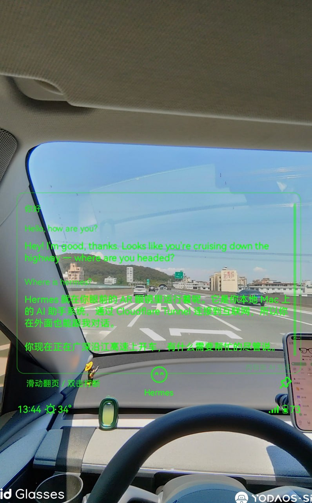
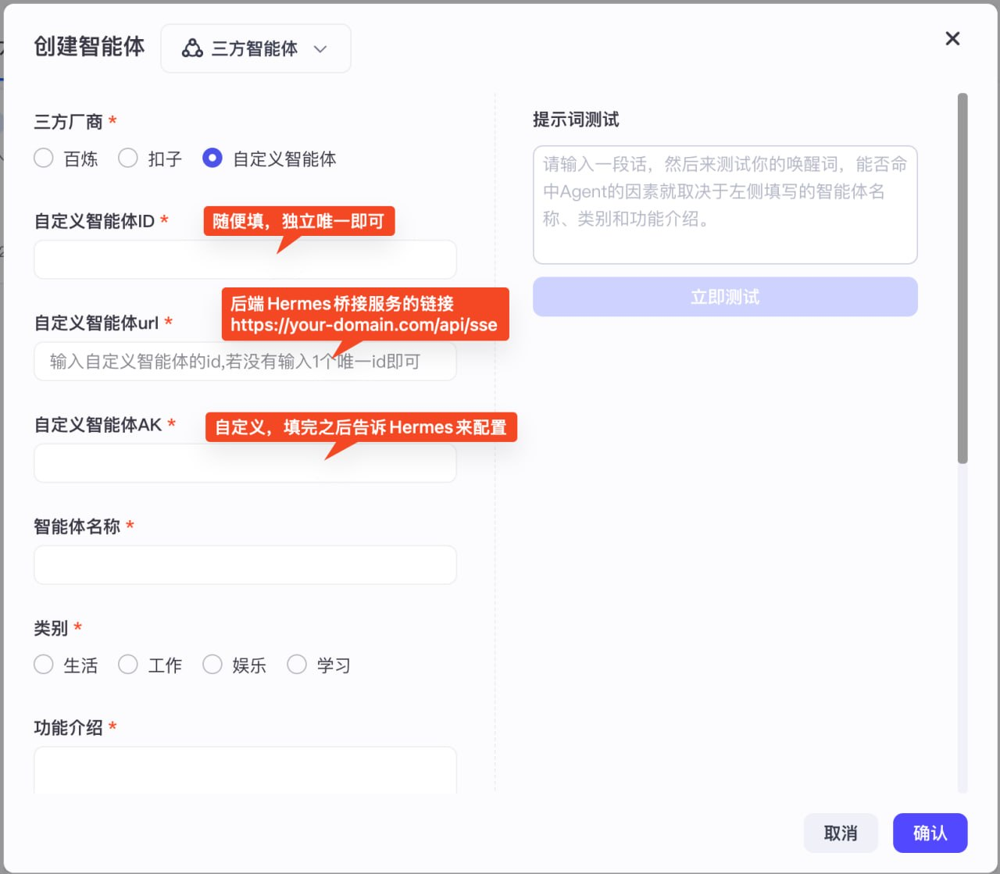

# Rokid → Hermes Bridge

将 Rokid AR 眼镜通过灵珠平台（Rizon）接入 [Hermes Agent](https://github.com/nousresearch/hermes-agent)，实现眼镜语音对话。



> 实拍：开车时通过 Rokid 眼镜与 Hermes 语音对话，HUD 实时显示 AI 回复

## 架构

```
Rokid 眼镜 → Rokid AI App → 灵珠平台 → Cloudflare Tunnel → 本地桥接服务(:8900) → Hermes Gateway(:8642) → LLM
```

## 功能

- 🎤 语音适配：自动去 markdown，回复口语化简短
- 🖼️ 图片识别：眼镜拍照自动转 base64 调用视觉模型
- 💬 多轮上下文：按用户隔离，最近 5 轮对话记忆
- 💾 会话持久化：对话自动写入 Hermes session DB
- 🧠 记忆提取（可选）：自动提取用户偏好写入记忆系统
- 🔄 自动重试 + SSE 心跳保活

## 快速开始

### 1. 安装依赖

```bash
pip install -r requirements.txt
```

### 2. 配置

```bash
cp .env.example .env
# 编辑 .env，填入你的配置
```

### 3. 启动

```bash
python src/main.py
```

### 4. 配置 Cloudflare Tunnel

参考 [docs/cloudflare-tunnel.md](docs/cloudflare-tunnel.md) 将本地服务暴露到公网。

### 5. 配置灵珠平台

1. 访问 [灵珠平台](https://agent-develop.rokid.com/)
2. 创建三方智能体 → 选择「自定义智能体」
3. URL 填 `https://your-domain.com/api/sse`
4. 鉴权方式选 Bearer Token，AK 填你 .env 中的 `ROKID_AK`



⚠️ **不要点击「提审」**，未提审的智能体只有自己能用。

## 前置条件

- Rokid 眼镜（支持 Rokid AI App 的型号）
- Hermes Agent 已安装并运行（含 Gateway）
- 公网域名或 Cloudflare Tunnel
- Python 3.10+

## 文档

- [故障排查](docs/troubleshooting.md)
- [Cloudflare Tunnel 配置](docs/cloudflare-tunnel.md)
- [灵珠 SSE 协议](docs/lingzhu-protocol.md)
- [开机自启动（macOS/Linux）](docs/autostart.md)

## License

MIT
